# Plataforma de Donaciones Seguras: AQP-SOLIDARIA

**Informe técnico de implementación, despliegue y validación**<br>
Universidad Nacional de San Agustín de Arequipa — EPIS<br>
Asignatura: Tópicos Avanzados en Ingeniería de Software<br>
Práctica: Plataforma de Donaciones Segurida - AQP-SOLIDARIA<br>
Docente: Mg. Robert Edison Arisaca Mamani<br>
Integrantes: Cusilayme García José Luis; Joel Antonio Chino Pari; Mamani Mamani Alexis Baltazar; Mamani Uscamayta Agustín David<br>
Fecha: 12 de noviembre de 2026

Word y PDF utilizan la plantilla de laboratorio proporcionada por el equipo. La retroalimentación se conserva en blanco para el docente. El número de práctica y la hora de presentación no fueron indicados: se señalan como por asignar y por definir. Las referencias de revisión por pares deben completarse con datos reales.

## 1. Resumen del trabajo

Repositorio del proyecto [6]: https://github.com/TrustMek7/ZTA. La URL fue proporcionada por el equipo; las pruebas locales no acreditan por sí solas un push o CI remoto.

Aplicación desplegada: https://d22p2zux1ennmn.cloudfront.net.

AQP-SOLIDARIA es un prototipo académico para publicar proyectos sociales ficticios, registrar intenciones de donación en soles y simular sus resultados. Se implementó una aplicación React con TypeScript y una API serverless en AWS. No se procesan pagos ni se solicitan tarjetas, CVV, DNI o credenciales bancarias. El propósito es demostrar autenticación, autorización por recurso, mínimo privilegio, trazabilidad e integridad de operaciones concurrentes.

El entorno académico quedó desplegado en Ohio, us-east-2. El frontend se distribuye mediante CloudFront desde un bucket S3 privado; API Gateway invoca funciones Lambda que operan sobre DynamoDB. Cognito administra usuarios, grupos, autenticación mediante código con PKCE y segundo factor TOTP. Se prepararon cincuenta proyectos publicados para evaluar rendimiento, además de proyectos de control creados por las suites posteriores.

Durante la validación se detectó una regresión de autenticación: se exigió una audiencia de recurso que los access tokens emitidos por Cognito no incluían. Esto produjo respuestas 401 para usuarios autenticados. El commit a7bc403 restauró la validación del app client, mantuvo la comprobación criptográfica de Gateway y trasladó la decisión obligatoria de scopes y tipo de token a cada Lambda protegida. Después del despliegue se observó la consulta exitosa del auditor y el rechazo 401 del ID token. Se conserva el incidente y su corrección como evidencia del proceso.

Este informe distingue resultados automáticos, observaciones directas y salidas proporcionadas por el titular. Una captura de interfaz no demuestra por sí sola todos los controles del backend. Tampoco se presenta la configuración como una certificación integral de Zero Trust o de cumplimiento normativo.

## 2. Alcance y requisitos

Las fuentes normativas del proyecto son requirements.md, versión 2.0, y design.md [1]. Las historias HU-01 a HU-09 y HU-11 conforman el MVP; HU-10 y HU-12 son extensiones. El flujo central comprende catálogo, detalle, autenticación, intención pendiente, simulación de confirmación o rechazo, historial propio, gestión de proyectos y totales agregados.

| Operación | Visitante | DONANTE | GESTOR | AUDITOR |
|---|---|---|---|---|
| Consultar proyectos publicados y agregados | Sí | Sí | Sí | Sí |
| Registrar y simular donación propia | No | Sí | No | No |
| Consultar historial propio | No | Sí | No | No |
| Crear y publicar proyectos | No | No | Sí | No |
| Consultar eventos de auditoría | No | No | No | Sí |

Los grupos pertenecen a Cognito y no equivalen a roles IAM. La matriz exige que el gestor no done, incluso a proyectos ajenos. Permitirle donar sería un cambio de requisitos; no se implementó esa interpretación. Se utilizaron cuentas separadas para gestor y dos donantes, evitando cambiar el grupo de una identidad para aparentar dos propietarios distintos. La configuración MFA del pool es obligatoria para todas las cuentas, más estricta que el mínimo solicitado para gestor y auditor.

## 3. Arquitectura y decisiones

La siguiente tabla vincula los criterios funcionales con los módulos y pruebas. La aprobación de una llamada negativa no sustituye la revisión de los demás criterios de su historia.

| Historia y criterios | Implementación y validación |
|---|---|
| HU-01: CA-01.1, CA-01.2 y CA-01.3 | Catálogo de publicaciones, ocultación de borradores T01 y captura inicial de estado vacío |
| HU-02: CA-02.1 y CA-02.2 | Detalle y agregados sin datos de donantes; detalle inexistente y borrador 404 |
| HU-03: CA-03.1 y CA-03.2 | Code + PKCE, pruebas T02 y T11; tokens de otro cliente y expiración cubiertos por guardas locales |
| HU-03: CA-03.3 y CA-03.4 | Tokens de diez minutos, eliminación de memoria al salir y prueba T13 de revocación/expiración |
| HU-04: CA-04.1, CA-04.2 y CA-04.3 | Roles y claims verificados; pruebas T03, T09 y T12; no se acepta identidad del cuerpo |
| HU-05: CA-05.1, CA-05.2 y CA-05.3 | Creación pendiente y validaciones T04–T05; identidad del servidor y pruebas de propiedades extra |
| HU-05: CA-05.4 y CA-05.5 | T06–T07, atomicidad y formulario sin datos de pago |
| HU-06: CA-06.1 y CA-06.2 | Propiedad, condición SAM academic y diez solicitudes concurrentes T08–T09 |
| HU-06: CA-06.3 y CA-06.4 | Rechazo sin incremento y aviso académico visible en todas las capturas |
| HU-07: CA-07.1 y CA-07.2 | Historial propio, claves sin duplicados y prueba BOLA T09 |
| HU-08: CA-08.1, CA-08.2 y CA-08.3 | Creación de borrador, publicación, conflicto 409 en repetición y evento de auditoría |
| HU-09: CA-09.1 y CA-09.2 | Agregados de confirmadas, importes PEN y ausencia de identidad en datos públicos |
| HU-11: CA-11.1 y CA-11.2 | TOTP obligatorio en el pool; gestor y auditor autenticados; prueba controlada T14 |
| HU-10: CA-10.1 y CA-10.2, extensión | Consulta del auditor y eventos seudonimizados; filtro por tipo disponible, filtro de fecha pendiente |
| HU-12: CA-12.1 y CA-12.2, extensión | No implementada; las decisiones del MVP permanecen en Lambda |

El navegador obtiene el HTML y los recursos estáticos por HTTPS desde CloudFront. S3 permanece privado y CloudFront utiliza Origin Access Control. La SPA redirige a Cognito para iniciar sesión; el intercambio utiliza Authorization Code con PKCE, sin secreto de cliente en el navegador. Los access tokens se mantienen en memoria. El estado transitorio y el verificador PKCE se almacenan en sessionStorage durante la redirección, sin convertirlo en un almacén persistente de tokens.

La SPA llama a API Gateway con Authorization: Bearer. Las rutas privadas conservan el authorizer JWT, que verifica emisor, firma, vigencia y audiencia o client_id. Lambda comprueba token_use=access, client_id, expiración, scope de la operación, grupo y propiedad del recurso. El resultado distingue una credencial inválida, 401, de una identidad autenticada sin permiso, 403. Para recursos ajenos se admite 404 opaco según el caso de prueba.

| Componente | Función y límite de confianza |
|---|---|
| React, Vite, Tailwind | Presentación adaptable y validación orientativa; no decide permisos efectivos |
| Cognito | Identidad, grupos, TOTP y emisión de tokens |
| API Gateway HTTP API | Verificación criptográfica JWT, CORS, límites de tráfico y acceso HTTP |
| Lambda PublicProjects | Lectura pública de publicaciones y agregados; sin permiso de escritura en proyectos |
| Lambda ManageProjects | Creación y publicación por GESTOR |
| Lambda CreateDonation y History | Registro por DONANTE y acceso exclusivo al historial propio |
| Lambda Simulate | Transición simulada propia; recurso condicionado al stage academic |
| Lambda Audit | Consulta autorizada de eventos por AUDITOR |
| DynamoDB | Proyectos, donaciones, idempotencia y eventos de auditoría |
| CloudWatch y SAM | Observabilidad y definición reproducible de infraestructura |

Los importes se almacenan como enteros en céntimos, con currency=PEN. Las donaciones admiten entre S/ 1.00 y S/ 1000.00. Se validan tipos, límites y propiedades inesperadas mediante Zod. El servidor obtiene la identidad del JWT verificado; no acepta un donorSub arbitrario enviado por el cliente.

La creación usa una clave UUID de idempotencia. La repetición de la misma clave con la misma carga devuelve la intención original; con una carga diferente genera conflicto 409. La confirmación y el incremento agregado se ejecutan mediante una transacción condicionada en DynamoDB. Solamente PENDIENTE_SIMULACION puede pasar a CONFIRMADA_SIMULADA o RECHAZADA_SIMULADA. Confirmar dos veces no puede incrementar dos veces; rechazar no modifica el acumulado. El endpoint de simulación no se habilita en production.

## 4. Paso a paso de preparación y despliegue

### 4.1. Cuenta y segundo factor

Se creó una cuenta AWS Free plan y se verificó en la consola el saldo inicial de créditos y los días disponibles. La experiencia mostrada correspondió al acceso nuevo mediante Builder ID. Se registró TOTP en la sección Seguridad del perfil. Este MFA protege el acceso a la cuenta; el MFA de los usuarios de la aplicación se configura separadamente en Cognito.

Las imágenes originales con información de contacto, listas de correos o QR de enrolamiento no se incorporan al informe. Un QR de MFA permite reconstruir el segundo factor y no debe publicarse como evidencia académica. Se utiliza en su lugar una captura del desafío de verificación sin código introducido.

### 4.2. Región y CloudShell

Se trabajó finalmente en us-east-2. El intento inicial en us-east-1 recibió una denegación explícita de una política SCP al crear los recursos administrados de SAM. La solución fue utilizar la región asignada al proyecto, sin ampliar permisos ni modificar políticas de la organización. La región indicada por el panel del asistente no constituyó una verificación de la región autorizada.

En CloudShell se comprobaron las herramientas:

```bash
sam --version
node --version
```

La primera comprobación mostró SAM CLI 1.166.2 y Node 20.20.2. Se instaló Node 24 y se verificó v24.22.3 antes de compilar el runtime nodejs24.x. La instrucción nvm install inicialmente falló porque nvm no estaba instalado; el registro conserva la verificación final satisfactoria.

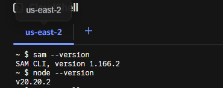

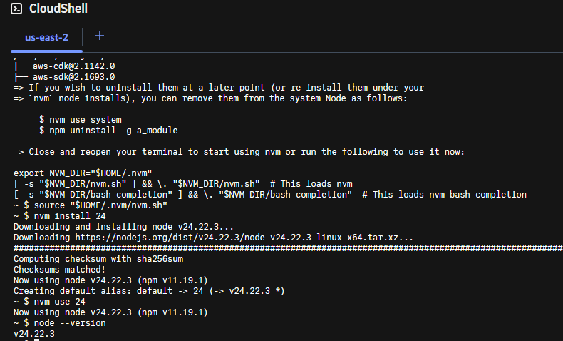

### 4.3. Carga del repositorio y compilación

El código se cargó con la opción de archivos de CloudShell y se extrajo dentro de ~/aqp-solidaria. Las dependencias se instalan a partir del lockfile. El script build verifica TypeScript, genera dist/ para la SPA y dist-backend/lambda.js para Lambda.

```bash
cd ~/aqp-solidaria
npm ci
npm run build
sam validate --lint --template-file infra/template.yaml --region us-east-2
sam build --template-file infra/template.yaml
```

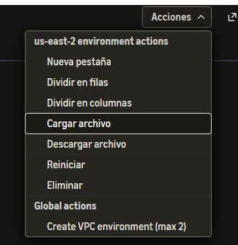

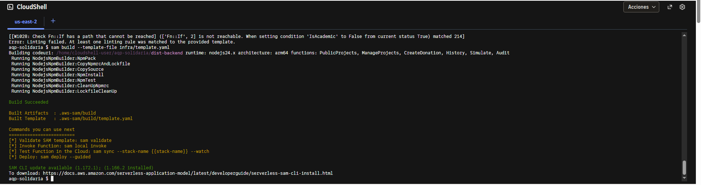

La primera validación identificó W1028 por una rama condicional inalcanzable generada por SAM. Se corrigió la definición condicional de la ruta de simulación, conservando la exclusión del recurso fuera del entorno académico. Cuando se subió template.yaml al directorio personal, se reemplazó el archivo correcto con:

```bash
cp ~/template.yaml ~/aqp-solidaria/infra/template.yaml
```

Se volvió a ejecutar lint y build. Las advertencias posteriores de Rollup sobre anotaciones PURE en Zod no impidieron la compilación; el build terminó correctamente. Estas advertencias de dependencias no se presentan como errores de negocio.

### 4.4. Despliegue guiado

```bash
sam deploy --guided --region us-east-2
```

| Pregunta | Valor utilizado |
|---|---|
| Stack Name | aqp-solidaria-academic |
| AWS Region | us-east-2 |
| Stage | academic |
| CognitoDomainPrefix | aqp-solidaria-jlc-2026 |
| Confirm changes before deploy | Y |
| Allow SAM CLI IAM role creation | Y |
| Disable rollback | N |
| Save arguments | Y |
| SAM configuration file | Enter para aceptar samconfig.toml |
| Configuration environment | Enter para aceptar default |

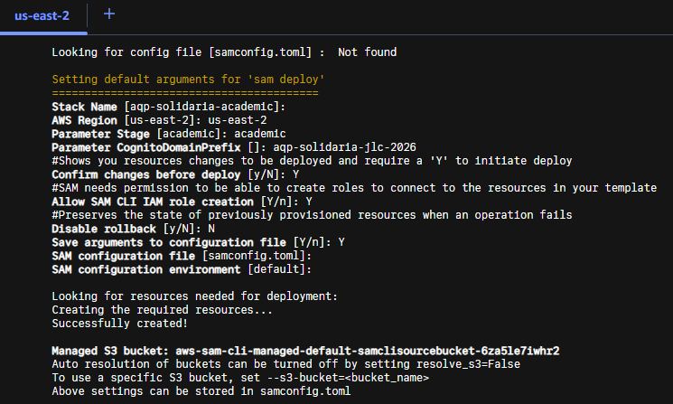

Se revisó el changeset y se confirmó su aplicación. Los parámetros se conservan en la configuración SAM [4]. Los parámetros se conservan en la configuración SAM [4]. Los parámetros se conservan en la configuración SAM [4]. Durante CREATE_IN_PROGRESS o UPDATE_IN_PROGRESS no es necesario pulsar Enter: SAM espera y muestra eventos hasta completar la operación. La salida satisfactoria de CloudFormation confirmó la creación y, más adelante, la actualización de la pila.

### 4.5. Configuración y publicación del frontend

Los outputs públicos proporcionaron la URL de API, issuer Cognito, app client, dominio de login, bucket y distribución. Se configuraron las variables VITE correspondientes en el entorno local de compilación, sin registrar secretos. El client ID de una SPA pública no es un secreto de cliente.

| Salida | Valor del entorno académico |
|---|---|
| FrontendUrl | https://d22p2zux1ennmn.cloudfront.net |
| ApiUrl | https://wqn3zzrxf5.execute-api.us-east-2.amazonaws.com/academic |
| WebsiteBucket | aqp-solidaria-academic-website-2f8osw5c1ygo |
| DistributionId | EHVO2NNRUVJ8J |
| UserPoolId | us-east-2_OaIp2x24l |

```bash
npm run build
aws s3 sync dist/ s3://aqp-solidaria-academic-website-2f8osw5c1ygo/ --region us-east-2
aws cloudfront create-invalidation --distribution-id EHVO2NNRUVJ8J --paths '/*'
```

La invalidación InProgress indica que CloudFront está propagando el cambio. El sitio se abrió por HTTPS y presentó inicialmente un catálogo sin proyectos. No se utilizó el endpoint público de sitio web de S3.

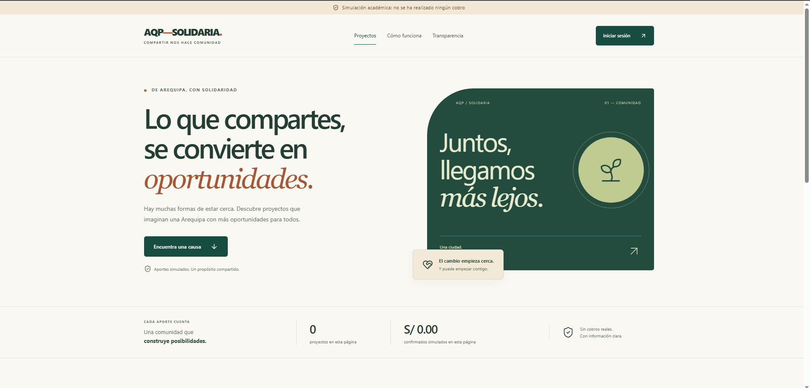

### 4.6. Usuarios y grupos Cognito

En Amazon Cognito se abrió el pool aqp-solidaria-academic-users, Administración de usuarios y Usuarios. Se creó cada cuenta con correo de prueba y contraseña temporal. Se agregó cada identidad al grupo correspondiente: GESTOR, DONANTE o AUDITOR. Se crearon dos donantes distintos para comprobar el aislamiento de datos.

Al primer inicio se cambió la contraseña temporal y se completó el registro del segundo factor exigido por el pool. Después de modificar grupos se cerró sesión y se obtuvo un token nuevo: un token emitido antes del cambio no actualiza sus claims por sí solo. No se utilizaron roles IAM para conceder permisos funcionales de la aplicación.

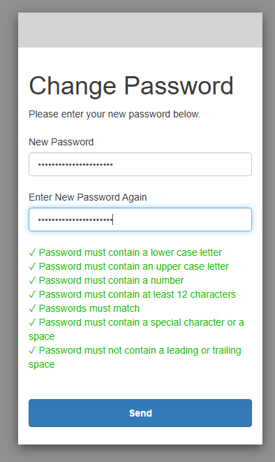

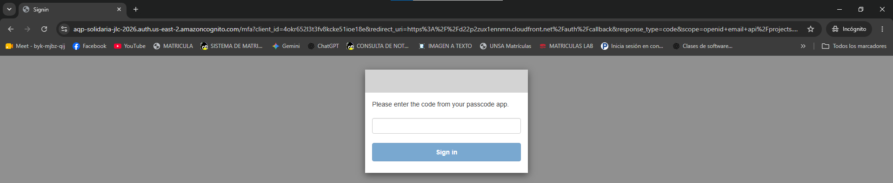

### 4.7. Creación y publicación de una campaña

Con GESTOR se accedió a Gestión y se creó Una mesa para todos, con finalidad ficticia de apoyo a comedores comunitarios y meta S/ 18000.00. El proyecto se guardó en BORRADOR. Se publicó desde el flujo de gestión y luego se comprobó su aparición en el catálogo.

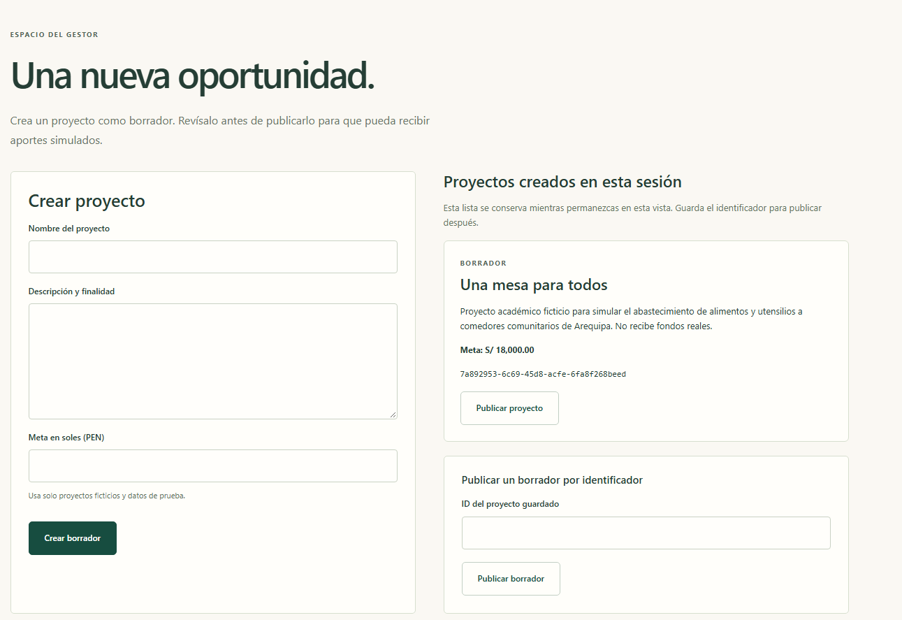

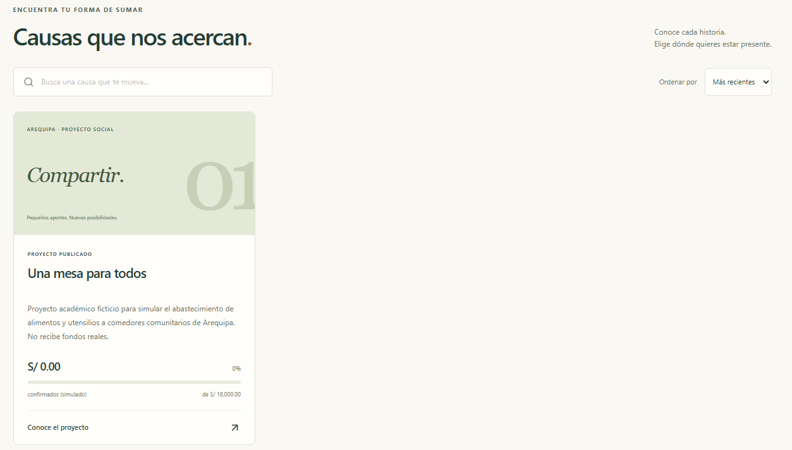

### 4.8. Donación simulada e historial

Con DONANTE se abrió el detalle, se introdujo S/ 10.00 y se registró la intención. La creación pendiente no incrementó el acumulado. Al simular confirmación, la intención pasó a CONFIRMADA_SIMULADA y el total aumentó a S/ 10.00. Otra intención de S/ 100.00 se rechazó y el acumulado permaneció en S/ 10.00. El historial mostró ambos resultados.

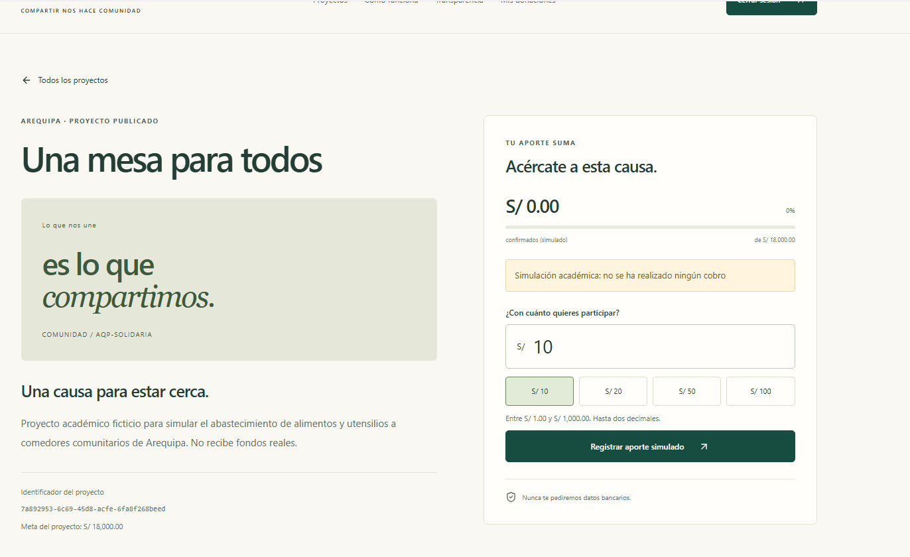

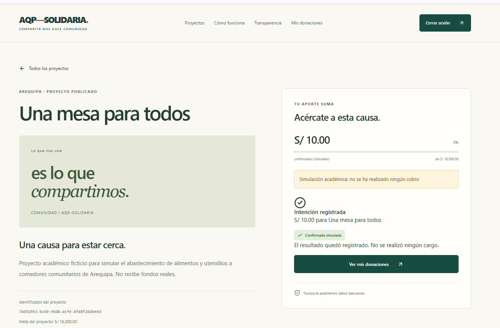

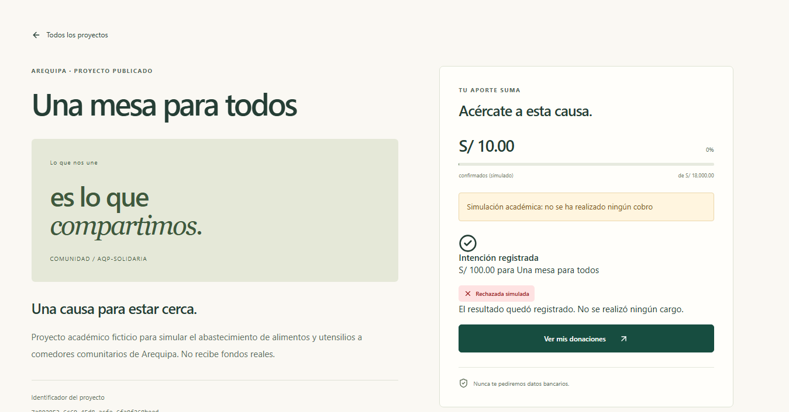

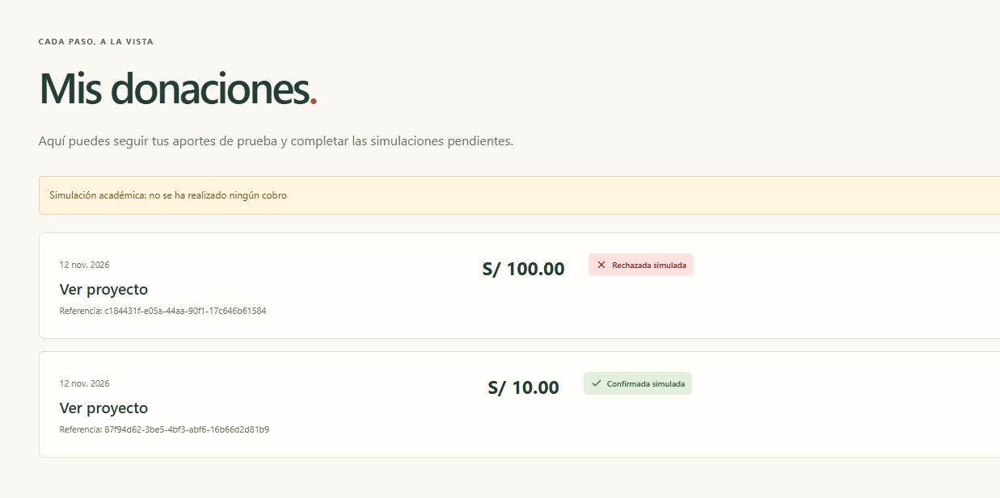

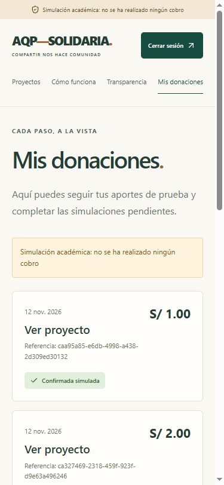

## 5. Estrategia y resultados de pruebas

Se combinaron pruebas unitarias y de componentes con Vitest, pruebas de navegador con Playwright, validación de SAM y llamadas HTTP contra el entorno real. Los scripts cloud generan reportes JSON sin credenciales en .artifacts/. Las pruebas que crean datos utilizan nombres de control QA y únicamente importes simulados.

La suite inicial ejecutada por el titular obtuvo trece comprobaciones aprobadas, una fallida por entrada incorrecta del ID token y tres comprobaciones pendientes de evidencia externa. La entrada incorrecta no demostraba aceptación de un ID token por la API. Posteriormente se probó un ID token real, se detectaron los problemas de códigos HTTP y se corrigió la configuración. No se sustituye el resultado inicial por un éxito retrospectivo.

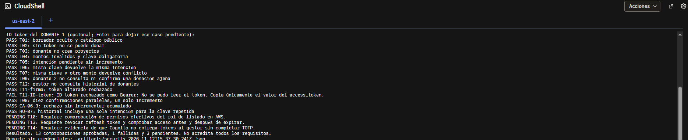

| Caso | Procedimiento y resultado exigido | Evidencia y alcance |
|---|---|---|
| T01 | Borrador no listado y detalle 404; publicaciones visibles | Suite inicial aprobada; repetición pública posterior aprobada |
| T02 | POST de donación sin token devuelve 401 | Suite inicial y repetición pública aprobadas |
| T03 | DONANTE intenta crear proyecto y recibe 403 | Suite inicial aprobada; repetir en ejecución autenticada posterior |
| T04 | Cero, negativos, fuera de rango, decimales de céntimo y ausencia de clave se rechazan | Suite inicial aprobada; pruebas locales de validación |
| T05 | Intención pendiente no incrementa total | Repetici?n autenticada final y flujo capturado |
| T06 | Repetir clave y carga devuelve la intención original | Repetici?n autenticada final aprobada |
| T07 | Misma clave con importe diferente devuelve 409 | Repetici?n autenticada final aprobada |
| T08 | Diez confirmaciones simultáneas producen un incremento | Repetici?n final: una respuesta 200 y nueve 409 |
| T09 | Segundo donante no consulta ni confirma el recurso ajeno | Repetici?n autenticada final aprobada con identidades distintas |
| T10 | Rol de lectura no puede escribir en DynamoDB | IAM Policy Simulator: GetItem allowed, PutItem implicitDeny, sin contexto faltante |
| T11 | ID token o firma alterada como Bearer recibe 401 | Firma alterada aprobada inicialmente; ID token real 401 tras a7bc403 |
| T12 | GESTOR no consulta historial de un donante | Repetici?n autenticada final aprobada |
| T13 | Access token válido tras cierre hasta expirar y rechazado después | Reporte recuperado: 200 antes, 200 después del cierre y 401 tras expirar |
| T14 | GESTOR no obtiene tokens sin completar TOTP | Captura del desafío disponible; verificar de forma controlada la ausencia de emisión previa |

Las filas con evidencia histórica no equivalen a una repetición completa sobre la última versión. El anexo de resultados automáticos incorpora la ejecución final cuando esta termina. T10, T13 y T14 requieren procedimientos externos al script principal; su marcador PENDING no se convierte automáticamente en FAIL ni en PASS por ejecutar de nuevo los otros casos.

### 5.1. Corrección de autenticación y prueba del auditor

La prueba negativa distinguió dos problemas. Primero, un ID token recibió 403 por la comprobación de scopes en Gateway, en lugar del 401 esperado. Después se intentó exigir aud mediante resource binding, pero los access tokens reales no contenían esa audiencia; el cambio provocó 401 también para donantes y auditor.

La corrección a7bc403 usa el comportamiento documentado de HTTP API [3]: si aud no está presente, el authorizer compara client_id con su audiencia configurada. El backend rechaza token_use distinto de access antes de consultar datos y exige el scope de cada operación. Se conserva Cognito Lite y no se agregó una migración a Managed Login ni un cambio de plan.

Después del despliegue se observó la pantalla de auditoría con eventos PROJECT_CREATED, fechas, actor seudonimizado, recurso y resultado SUCCESS. Una llamada con el access token del auditor al historial de donaciones devolvió 403 y la llamada equivalente con ID token devolvió 401. La herramienta antigua imprimió passed=false porque esperaba un 200 de un DONANTE en ese endpoint; para un AUDITOR ese 403 es el resultado correcto. El informe conserva esa diferencia y no interpreta el indicador de forma aislada.

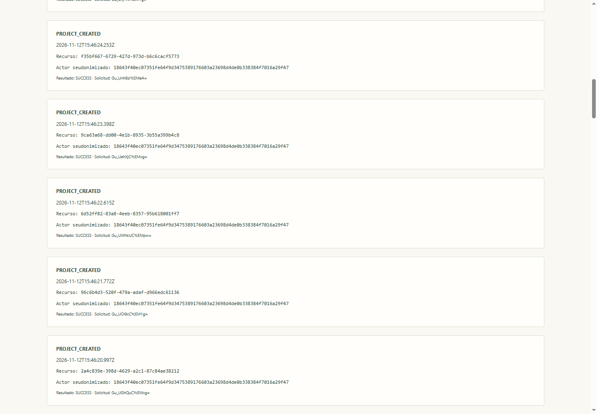

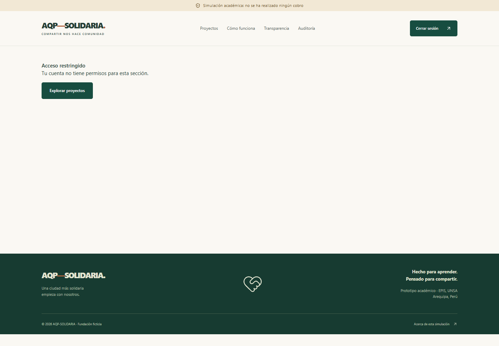


### 5.2. Mínimo privilegio: T10

La primera simulación IAM devolvió explicitDeny para ambas operaciones por falta del contexto adecuado. Se repitió incorporando aws:RequestedRegion=us-east-2. El resultado final sobre la tabla Projects fue GetItem allowed y PutItem implicitDeny, con ContextoFaltante vacío y AllowedByOrganizations=true. Esto satisface la alternativa de IAM Policy Simulator prevista en T10; no implica que la función haya intentado escribir realmente en producción.

### 5.3. Ventana de revocación: T13

Se ejecutó node scripts/cloud/revocation.mjs con una sesión del donante. El cierre debía utilizar el botón de la aplicación, no solamente cerrar la pestaña. El resultado se recuperó del JSON después de cerrarse la consola.

| Fase | Marca UTC | HTTP |
|---|---|---|
| Antes del cierre | 18:04:12.163 | 200 |
| Después del cierre, antes de expirar | 18:05:16.779 | 200 |
| Expiración declarada en el token | 18:13:47.000 | — |
| Después de expirar | 18:13:57.427 | 401 |

El reporte identifica PASS_ACCESS_TOKEN_WINDOW. La distinción entre revocación en Cognito y validación local del JWT está documentada por AWS [5]. La distinción entre revocación en Cognito y validación local del JWT está documentada por AWS [5]. La distinción entre revocación en Cognito y validación local del JWT está documentada por AWS [5]. Demuestra la ventana de aceptación del access token y su rechazo por expiración. La confirmación del operador de que cerró sesión no sustituye una comprobación independiente del éxito de /oauth2/revoke ni del rechazo de un refresh token revocado. Esa limitación se declara expresamente.

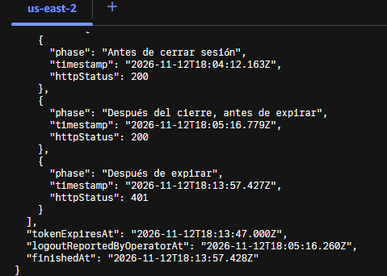

## 6. Rendimiento y observabilidad

El script seed creó cuarenta y ocho publicaciones adicionales hasta completar cincuenta, sin insertar donaciones. El rendimiento se midió con cien muestras por endpoint y cinco solicitudes de calentamiento excluidas por endpoint. Se utilizó el percentil empírico por ordenación de las muestras y se contrastó el umbral de 1500 ms.

| Endpoint | p95 en CloudShell, ms | p95 adicional desde Windows, ms |
|---|---|---|
| GET /projects | 87.98 | 161.59 |
| GET /projects/{id} | 34.19 | 149.12 |
| GET /projects/{id}/stats | 37.91 | 204.47 |

Las mediciones corresponden a ejecuciones y clientes diferentes. La primera fue ejecutada por el titular en CloudShell y su captura muestra el entorno de Ohio. La segunda fue ejecutada desde Windows; la ubicación física del cliente no quedó registrada y no se usa para acreditar cercanía regional. Ambas estuvieron por debajo del umbral, pero no deben mezclarse para calcular un único percentil.

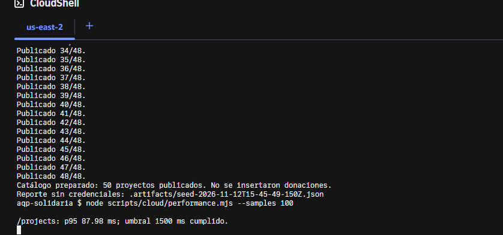

Se revisó CloudWatch en el intervalo 15:47–15:49 UTC del 12 de noviembre. Los eventos mostraron solicitudes exitosas y, al filtrar Init Duration en el grupo de PublicProjects, no aparecieron coincidencias para ese intervalo. Esta revisión apoya la ausencia de cold starts en la ventana inspeccionada; excluir cinco llamadas de calentamiento por sí solo no demostraría lo mismo. El JSON original no se modifica para convertir una revisión manual posterior en una verificación automática.

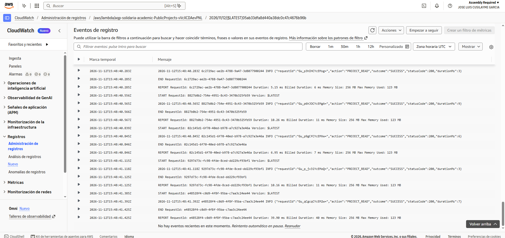

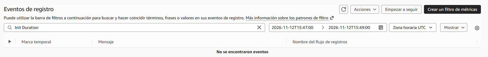

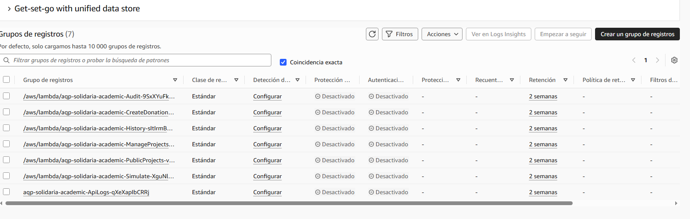

Los registros de aplicación incluyen requestId, acción, resultado, estado HTTP y duración. La política de retención configurada es de catorce días. La inspección de ejemplos no sustituye una auditoría exhaustiva de todos los logs. Deben adjuntarse también evidencia de un rechazo 401/403 en CloudWatch y de cambios de infraestructura en CloudTrail para cerrar completamente CA-NF07.2.

## 7. Mapeo Zero Trust y amenazas

El mapeo sigue los principios de NIST SP 800-207 [2] dentro del alcance del prototipo.

| Principio de NIST SP 800-207 | Aplicación en AQP-SOLIDARIA | Límite declarado |
|---|---|---|
| 1. Fuentes de datos y servicios son recursos | API, tablas, funciones e identidades definidos individualmente | No cubre inventario corporativo externo |
| 2. Comunicación protegida independientemente de ubicación | HTTPS en frontend, login y API | No se presume confianza por la red del cliente |
| 3. Acceso por sesión y mínimo privilegio | JWT en cada llamada, roles exclusivos y propiedad | Access token válido conserva su ventana hasta expirar |
| 4. Política dinámica según identidad y atributos | Grupo, scope, propietario, estado de recurso y stage | Sin evaluación continua de postura o riesgo |
| 5. Medición de integridad y postura de activos | Infraestructura versionada y pruebas de controles | No se implementa comprobación de postura del dispositivo |
| 6. Autenticación y autorización antes de acceso | Cognito con MFA, authorizer JWT y guardas backend | Sin un motor externo de decisiones para el MVP |
| 7. Información del estado para mejorar seguridad | Eventos, CloudWatch y análisis de resultados | Sin SIEM ni respuesta automática a incidentes |

El PEP se materializa en API Gateway y en las guardas de Lambda. El motor de decisión de autorización, PE, se implementa en las reglas del backend. Las funciones de administración de identidad y establecimiento de acceso, relacionadas con PA, se reparten entre Cognito, configuración OAuth y políticas desplegadas. Este es un mapeo funcional del prototipo; no se afirma una implementación completa de todos los componentes de una arquitectura empresarial NIST.

| Amenaza STRIDE | Control aplicado | Comprobación relevante |
|---|---|---|
| Suplantación | Cognito, PKCE, TOTP, firma JWT y token_use | T02, T11 y T14 |
| Manipulación | Esquemas, importes enteros, identidad del servidor y transacciones | T04–T08 |
| Repudio | Eventos con referencia de solicitud y actor seudonimizado | Consulta de auditoría |
| Divulgación | Propiedad de historial, respuestas opacas y agregados públicos | T09 y T12 |
| Denegación de servicio | Límites de tráfico y recursos serverless acotados | No se ejecutó una prueba de estrés destructiva |
| Elevación de privilegios | Matriz de roles, scopes e IAM por función | T03, T10 y T12 |

No se incluyen Verified Access, GuardDuty, Security Hub ni postura de dispositivos. La extensión con Amazon Verified Permissions no se presenta como implementada ni probada. La ausencia de esos servicios es un límite de alcance, no evidencia de que la red o el dispositivo sean confiables.

## 8. Calidad, accesibilidad y controles no funcionales

La última corrección pasó lint, TypeScript, cuarenta y dos pruebas Vitest, build frontend/backend, cuatro regresiones de traducción SAM y sam validate --lint. Las comprobaciones adicionales de herramientas cloud y Playwright se registran en el anexo de ejecución final. Estos resultados locales no acreditan por sí solos una ejecución de GitHub Actions en remoto.

La interfaz incluye etiquetas de formularios, estados de error, foco visible, enlace para saltar al contenido y vistas móviles. Se conservaron capturas a 375 px y pruebas de navegador de escritorio y móvil. No se declara conformidad completa WCAG 2.2 AA sin una revisión manual de teclado, contraste y tecnología de asistencia de todos los flujos.

| Requisito | Evidencia disponible | Trabajo de cierre |
|---|---|---|
| RNF-HU-01 HTTPS | URL HTTPS y llamadas reales | Inspección exhaustiva de ausencia de secretos |
| RNF-HU-02 identidad | JWT, scopes backend, rol y propiedad | Conservar resultados de repetición final |
| RNF-HU-03 mínimo privilegio | Roles por Lambda y T10 | Equivalencia del acceso Builder ID frente a usuarios IAM exigidos por rúbrica |
| RNF-HU-04 integridad | Transacción condicionada y T06–T08 | Conservar reporte de concurrencia |
| RNF-HU-05 rendimiento | Cincuenta proyectos, cien muestras por endpoint | Declarar condiciones de cliente y cold starts |
| RNF-HU-06 accesibilidad | UI adaptable y pruebas de navegador | Revisión manual WCAG aplicable |
| RNF-HU-07 observabilidad | Logs JSON y retención catorce días | Rechazo CloudWatch y evento CloudTrail |
| RNF-HU-08 calidad | SAM, pruebas y workflow versionados | PR revisado y CI remoto en verde |
| RNF-HU-09 presupuesto | Free plan observado y región us-east-2 | Evidencia de alerta AWS Budgets y limpieza posterior |
| RNF-HU-10 minimización | Sin datos bancarios; avisos académicos | Se usó correo personal del titular en cuentas: reemplazar por identidades de prueba si la rúbrica lo exige |
| RNF-HU-11 navegador | Tokens en memoria y cabeceras verificadas | Mantener revisión de dependencias y CSP |

La repetición pública comprobó HSTS, CSP, X-Content-Type-Options, Referrer-Policy y X-Frame-Options en CloudFront, además del catálogo, detalle, agregados y rechazo de solicitudes sin sesión. Un preflight OPTIONS 204 indica que la negociación CORS funcionó; no constituye evidencia del resultado del GET o POST que sigue.

## 9. Gestión del repositorio y uso de asistentes

La guía se encuentra en AGENTS.md y .agents/guia.md. Se estableció un plan incremental: análisis y diseño, estructura, interfaz, API, infraestructura, pruebas y documentación. Los commits utilizan exclusivamente la identidad Git configurada por el titular, sin trailers de coautoría ni firmas promocionales. La transparencia académica se conserva en AI_USAGE.md y en este apartado.

| Avance | Referencia de commit |
|---|---|
| Decisiones de diseño | 2252b2d |
| Estructura inicial | 35a28b2 |
| Interfaz | 701fccf |
| API y reglas | 8db4b72 |
| Infraestructura AWS | 62f0d9a |
| Pruebas | dd24208 |
| Documentación | ea49c57 |
| Condición SAM de simulación | 4b63dca |
| Scripts de validación cloud | f9ebf09 |
| Ventana de revocación | 99e9726 |
| Intento de audiencia de recurso, luego corregido | b6efff2 |
| Corrección compatible con access tokens Cognito | a7bc403 |

Se utilizó OpenAI Codex para implementación, pruebas y documentación. Se consultó Claude Code 2.1.322 para la dirección visual Sillar: fondos claros, verde y acentos cálidos. Claude Design no estuvo disponible y no se afirma una conexión inexistente. No se incorporaron fotografías ni logos externos; los elementos visuales se construyeron con componentes y recursos del repositorio.

El titular ejecutó los despliegues en CloudShell y aportó las capturas. Las sesiones de pruebas de navegador se abrieron con autorización y autenticación manual del titular. Los tokens necesarios para las pruebas se mantuvieron en memoria del proceso; no se copiaron al informe. La revisión por otro integrante, las referencias de PR y la defensa de decisiones siguen siendo responsabilidad del equipo y no se inventan en este documento.

## 10. Observaciones y cierre de entrega

La funcionalidad principal se demostró con publicación, confirmación, rechazo e historial; la consulta del auditor se observó después de corregir el incidente de tokens. El informe conserva los resultados previos y posteriores para evitar atribuir a la última versión pruebas ejecutadas sobre una anterior.

Para cerrar la evidencia de seguridad debe conservarse el reporte final de la repetición autenticada; verificar el resultado remoto de revocación y la ausencia de emisión de tokens antes de TOTP; y adjuntar los controles operativos pendientes de CloudTrail, Budgets, CI remoto y revisión por pares. Ninguna observación se etiqueta como caso aprobado sin prueba. La función de edición de proyectos incluida en la matriz general también requiere revisión de alcance, pues el flujo entregado de gestión cubre creación y publicación.

La eliminación de infraestructura se realizará después de la evaluación, con supervisión del titular. No se eliminan recursos mientras la demo sea necesaria. El procedimiento general es inventariar recursos, vaciar el bucket de la SPA cuando corresponda y ejecutar sam delete para la pila y región correctas. Deben revisarse los artefactos administrados de SAM y comprobar el inventario final. No se afirma que esta limpieza ya ocurrió.

## 11. Procedencia de imágenes y evidencias

El documento original recibido fue D:\Downloads\Capt.docx, con cuarenta y cinco imágenes. Se extrajeron sus archivos originales sin modificar el documento fuente. Se seleccionaron dieciocho imágenes para este informe, además de capturas autorizadas de la aplicación y dos imágenes aportadas en la conversación. manifest-evidencias.json registra origen y hash SHA-256 de cada archivo incluido. Las imágenes se escalan al presentar el documento; sus archivos fuente no se retocan.

Se excluyeron las imágenes con QR de enrolamiento MFA, datos de contacto, correos en formularios y listados, y algunas vistas duplicadas. También se omitieron capturas con identificadores de cuenta cuando no eran necesarias para demostrar el control. La selección protege la información del titular sin alterar la evidencia publicada. Las salidas IAM transcritas y algunos reportes originales permanecen en CloudShell; su descripción se identifica como evidencia proporcionada por el operador.

Los reportes JSON adjuntos no contienen JWT ni contraseñas. El paquete incluye una versión Word editable, PDF, HTML, Markdown, imágenes revisadas y resultados disponibles. El original Capt.docx no se redistribuye dentro del paquete porque contiene información que no debe publicarse.

## 12. Referencias técnicas

[1] Equipo AQP-SOLIDARIA, “Requerimientos — Plataforma de Donaciones Seguras,” ver. 2.0, 2 nov. 2026; “Diseño,” repositorio del proyecto, 2026.

[2] S. Rose, O. Borchert, S. Mitchell y S. Connelly, “Zero Trust Architecture,” NIST Special Publication 800-207, ago. 2020, doi: 10.6028/NIST.SP.800-207.

[3] Amazon Web Services, “Control access to HTTP APIs with JWT authorizers,” Amazon API Gateway Developer Guide. [En línea]. Disponible: https://docs.aws.amazon.com/apigateway/latest/developerguide/http-api-jwt-authorizer.html. [Accedido: 12-nov-2026].

[4] Amazon Web Services, “AWS SAM CLI configuration file,” AWS Serverless Application Model Developer Guide. [En línea]. Disponible: https://docs.aws.amazon.com/serverless-application-model/latest/developerguide/serverless-sam-cli-config.html. [Accedido: 12-nov-2026].

[5] Amazon Web Services, “Ending user sessions with token revocation,” Amazon Cognito Developer Guide. [En línea]. Disponible: https://docs.aws.amazon.com/cognito/latest/developerguide/token-revocation.html. [Accedido: 12-nov-2026].

[6] TrustMek7, “ZTA — AQP-SOLIDARIA,” repositorio de código, GitHub, 2026. [En línea]. Disponible: https://github.com/TrustMek7/ZTA. [Accedido: 12-nov-2026].

La referencia a la Ley N.° 29733 corresponde al alcance documental exigido para una eventual aplicación real; este prototipo no constituye un dictamen de cumplimiento legal.


## Anexo A. Repetici?n final contra el despliegue corregido

La ejecuci?n security-2026-11-12T19-26-47-121Z.json termin? con catorce comprobaciones PASS y cero FAIL. Se autenticaron un gestor y dos donantes distintos en contextos de navegador separados, introduciendo las credenciales manualmente. Los access tokens y el ID token se conservaron ?nicamente en memoria del proceso. La suite cre? un proyecto QA nuevo y dos donaciones simuladas; una se confirm? por S/ 1.00 y la otra se rechaz?. El cat?logo aument? respecto de las cincuenta publicaciones del benchmark, sin invalidar la medici?n hist?rica realizada antes.

| Comprobaci?n repetida | Resultado |
|---|---|
| T01 borrador oculto y cat?logo p?blico | PASS |
| T02 sin token no se dona | PASS |
| T03 donante no crea proyectos | PASS |
| T04 montos inv?lidos y clave obligatoria | PASS |
| T05 intenci?n pendiente sin incremento | PASS |
| T06 misma clave devuelve misma intenci?n | PASS |
| T07 misma clave y monto distinto | PASS, conflicto |
| T09 segundo donante no consulta ni confirma recurso ajeno | PASS |
| T12 gestor no consulta historial de donantes | PASS |
| T11 firma alterada | PASS, 401 |
| T11 ID token real como Bearer | PASS, 401 |
| T08 diez confirmaciones paralelas | PASS, un incremento |
| CA-06.3 rechazo no incrementa | PASS |
| HU-07 historial conserva una intenci?n por clave | PASS |

El reporte del script marca T10, T13 y T14 como PENDING porque estos procedimientos se comprueban por separado, no porque hayan fallado estas catorce llamadas. T10 cuenta con la evidencia del simulador IAM descrita en el cuerpo del informe. T13 y T14 se documentan con su evidencia independiente y el anexo posterior de sesi?n.

La repetici?n public-checks-2026-11-12T19-21-17-149Z.json aprob? ocho comprobaciones adicionales. En local se aprobaron ocho pruebas de herramientas cloud y cuatro pruebas Playwright de escritorio/m?vil. Los cuatro tests de infraestructura y las cuarenta y dos pruebas Vitest corresponden al c?digo corregido. No se suman estas cifras para declarar que todos los criterios de aceptaci?n est?n cubiertos: cada tipo de prueba tiene un alcance diferente.


## Anexo B. Evidencia controlada de MFA

La ejecuci?n session-checks-2026-11-12T19-28-01-267Z.json observ? el desaf?o MFA a las 19:29:08.119 UTC, con cero respuestas de emisi?n de tokens exitosas previas en el contexto nuevo. El titular complet? TOTP y se recibi? el token a las 19:31:51.847 UTC; se verific? el grupo GESTOR. T14 qued? aprobado. La captura oculta el campo de c?digo. Esta prueba demuestra el flujo observado y no constituye una prueba de fuerza bruta ni de todos los m?todos alternativos de autenticaci?n.

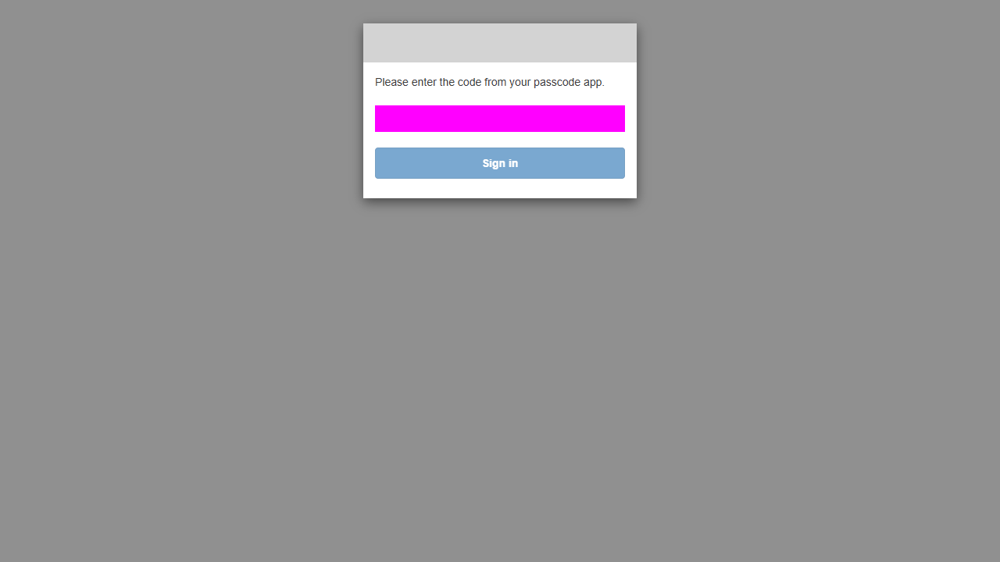

La parte manual de T13 de esa ejecuci?n no termin?: el donante cerr? sesi?n antes de que el observador estuviera listo y se agot? el tiempo de espera. Ese resultado parcial se conserva con su error; no se utiliza como evidencia de revocaci?n exitosa. Se inici? una repetici?n independiente que revoca autom?ticamente el refresh token de la misma sesi?n cuya ventana de access token se mide.

## Anexo C. Cierre de la repetición T13

Reporte: revocation-browser-2026-11-12T19-32-39-691Z.json. Resultado: **PASS**.

Se utilizó la misma sesión DONANTE para todas las fases. La revocación se ejecutó automáticamente con el refresh token de esa sesión, sin guardarlo. Se verificó también que el refresh token revocado ya no permitía renovar la sesión.

| Comprobación | Resultado HTTP |
|---|---|
| Revocar refresh token | 200 |
| Renovar con refresh token revocado | 400 |
| Antes de revocar (2026-11-12T19:33:46.441Z) | 200 |
| Despues de revocar y antes de expirar (2026-11-12T19:33:47.496Z) | 200 |
| Despues de expirar (2026-11-12T19:43:55.123Z) | 401 |

T13 queda aprobado en la repetición independiente: 200 antes de revocar, 200 después de revocar mientras el JWT seguía vigente y 401 después de expirar. T14 cuenta con la evidencia controlada del anexo B y T10 con IAM Policy Simulator. Los marcadores PENDING del script principal se resuelven con estas evidencias externas; sus reportes originales se conservan sin alterar. Los casos T01–T14 quedan comprobados con las procedencias indicadas. Esto no transforma en aprobados los requisitos operativos adicionales de Budgets, CloudTrail, revisión por pares o CI remoto.
